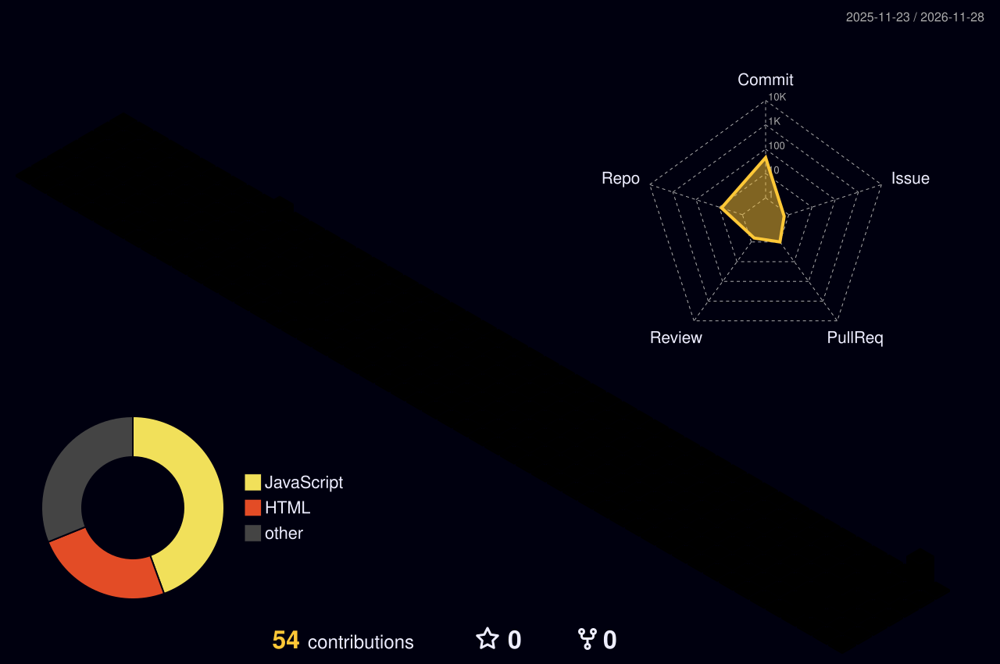

  

  

  
  
  

---

## ⚡ What I do

| | |
|---|---|
| 🖥️ **PC Optimization** | Windows 10/11 tools that cut input lag, boost FPS and remove bloat |
| 🤖 **Discord Bots** | Custom moderation and automation bots, built on demand |
| 🎨 **Design** | UI/UX, branding and clean interfaces, from Figma to production |

---

## 🚀 Featured

### 🖥️ [Unlag](https://unlag.pro): PC Optimizer
> A Windows 10/11 optimizer that cleans, tunes and speeds up your PC in a few clicks.

- Debloat, latency tweaks, startup and service management
- Lifetime license system
- AI-powered support chat

🔗 **[unlag.pro](https://unlag.pro)**

### 🤖 Discord Bots
> Moderation, anti-scam and automation bots with a web dashboard.

- Auto-moderation, logs, warnings, scam detection
- Custom features built to fit each server
- Private projects, not publicly listed

### 🎨 Design
> Interfaces, game GUIs, landing pages and brand identities.

- Everything designed in Figma, pixel-perfect and consistent

🔗 **[See the full portfolio → luro.lol](https://luro.lol)**

---

## 🛠️ Tech Stack

  

---

## 📊 Stats

  
  

  

---

## 🐍 Activity

  <picture>
    <source media="(prefers-color-scheme: dark)" srcset="https://raw.githubusercontent.com/0ser999/0ser999/output/github-snake-dark.svg" />
    <source media="(prefers-color-scheme: light)" srcset="https://raw.githubusercontent.com/0ser999/0ser999/output/github-snake.svg" />
    
  </picture>

  <a href="https://luro.lol">luro.lol</a>

  

